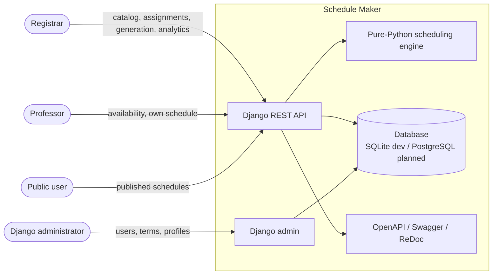
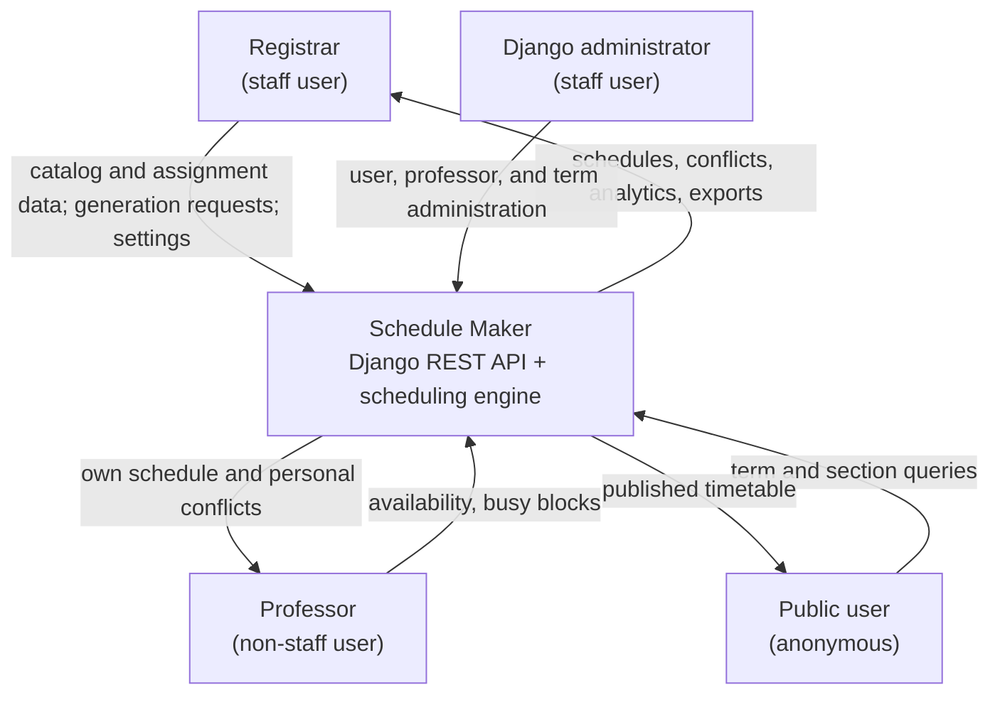
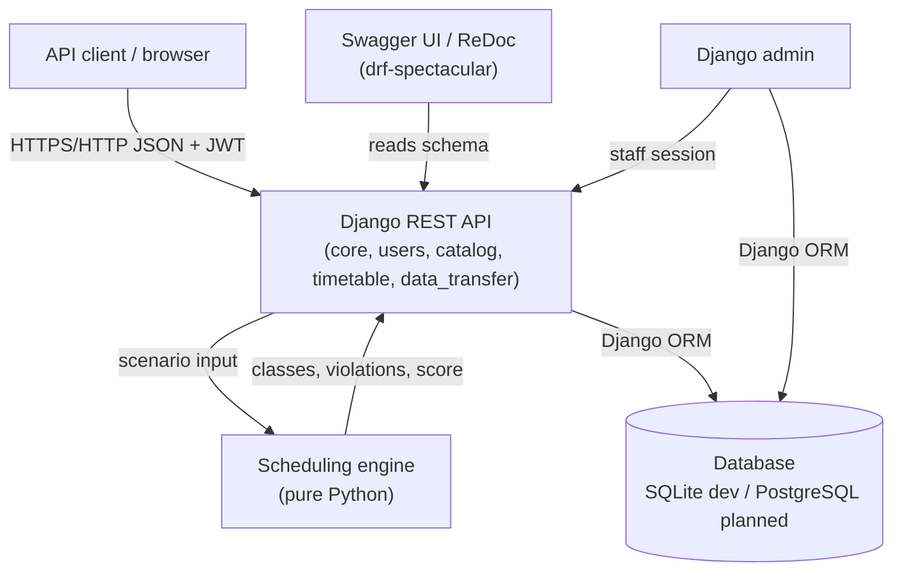
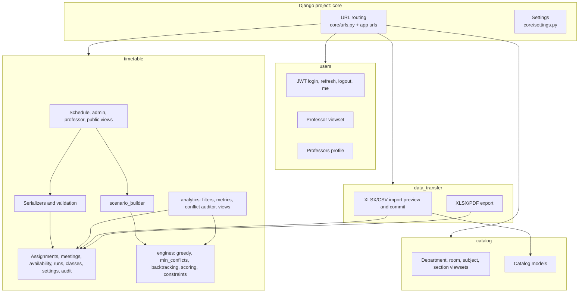

# Architecture

## Architectural style

Schedule Maker is a layered Django REST application with a pure-Python
scheduling core. The web layer handles authentication, validation, persistence,
and HTTP contracts; the engine receives an in-memory scenario and returns placed
classes and violations. There is no message broker, background worker, or
separate service in the current implementation.

## C4 Level 1 — System context

The system has no external payment, email, LMS, or calendar integration. All
data is stored locally in the configured database.

## C4 Level 2 — Containers

The planned React frontend is not part of the current container set. When it is
added, it should be an additional browser client that consumes the same API.

## C4 Level 3 — Components

### Application responsibilities

| App | Responsibility |
| --- | --- |
| `core` | Project settings, root URL routing, WSGI entry point |
| `users` | Authentication endpoints, professor profile model, professor viewset |
| `catalog` | Departments, rooms, subjects, sections and their serializers/viewsets |
| `timetable` | Assignments, meeting slots, availability, busy blocks, schedule runs, scheduled classes, settings, audit log, conflict resolutions, analytics, and the scheduling engine |
| `data_transfer` | Spreadsheet/CSV templates, import preview/commit, and XLSX/PDF schedule export |

### Key internal boundaries

- **HTTP layer** — DRF views and serializers validate input and enforce
  permissions.
- **Domain layer** — Django models encode uniqueness, choices, and check
  constraints.
- **Adapter layer** — `timetable/scenario_builder.py` is the only bridge from
  database models to the engine.
- **Engine layer** — `timetable/engines/` is pure Python and has no Django
  imports, so it can be unit-tested and reused independently.
- **Analytics layer** — `timetable/analytics/` uses Django ORM queries and the
  shared conflict auditor; it does not mutate schedule data.

## Request lifecycle

A typical protected request follows this path:

1. The client sends a JWT access token in the `Authorization` header.
2. DRF authenticates the user and applies the endpoint's permission class.
3. The view parses query parameters or a serializer validates the body.
4. The view reads or writes models through the Django ORM.
5. For generation, the scenario builder converts the active term to engine
   input, the engine runs, and the transaction persists the run and classes.
6. The response is serialized to JSON.

Analytics requests follow a similar path but only read data:
`resolve_context()` selects the term/run, metric builders query assignments,
classes, rooms, and availability, and the conflict auditor computes violations
on demand.

## Technology and deployment assumptions

| Concern | Current choice |
| --- | --- |
| Language/runtime | Python 3.14 |
| Web framework | Django 5.2 and Django REST Framework 3.15 |
| Authentication | simplejwt (JWT access/refresh, rotation, blacklist) |
| API schema | drf-spectacular with Swagger UI and ReDoc |
| Database | SQLite for development; PostgreSQL planned for production |
| Scheduling | Pure Python, synchronous request |
| Frontend | Planned React + Vite, not scaffolded |
| Async processing | None; generation blocks the request |

## Architecture decisions and trade-offs

- **Pure engine:** keeps algorithm code testable and portable, at the cost of an
  explicit adapter layer.
- **Synchronous generation:** simple to deploy and debug, but unsuitable for
  very large datasets or multi-minute runs without a background worker.
- **SQLite development database:** zero setup; PostgreSQL is the planned
  production database for concurrency, backups, and access control.
- **Dynamic conflict calculation:** analytics always reflect current data and do
  not depend on a conflict-resolution table that current operations do not
  populate. The cost is repeated computation.
- **Global settings table:** allows runtime configuration without a deployment;
  invalid values are validated at the API boundary.

## Known architectural gaps

The main architectural constraints are synchronous generation (no background
worker), the absence of a production settings split, and the missing
audit/conflict-resolution writes. See [Deployment: Current deployment
limitations](deployment.md#current-deployment-limitations) and [Security: Known
gaps](security.md#known-gaps) for the authoritative lists.

See [Data flow](data-flow.md) for process-level views and
[Deployment](deployment.md) for operational guidance.
