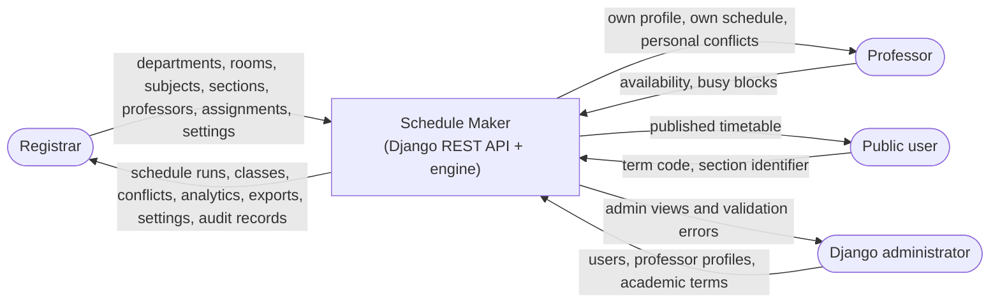
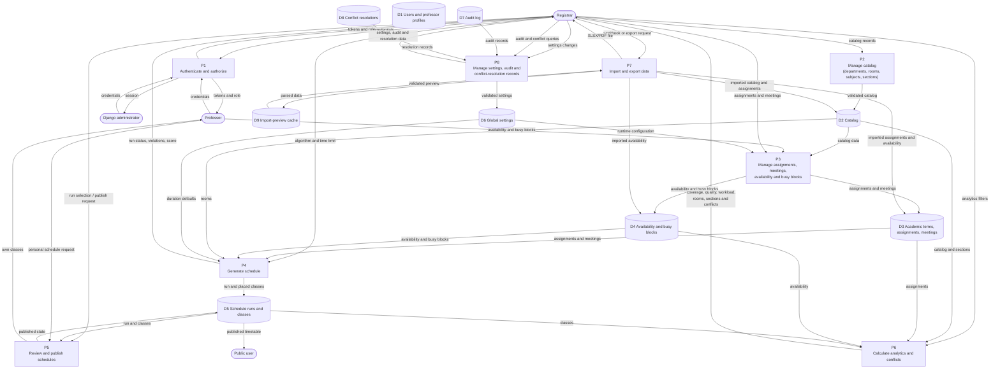
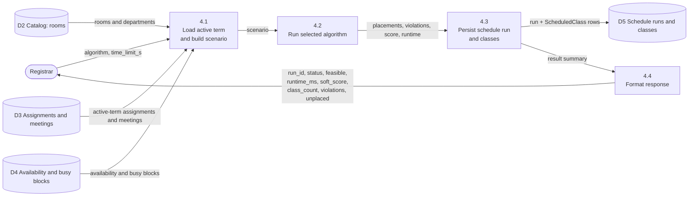
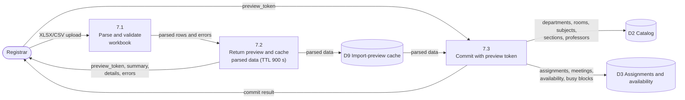
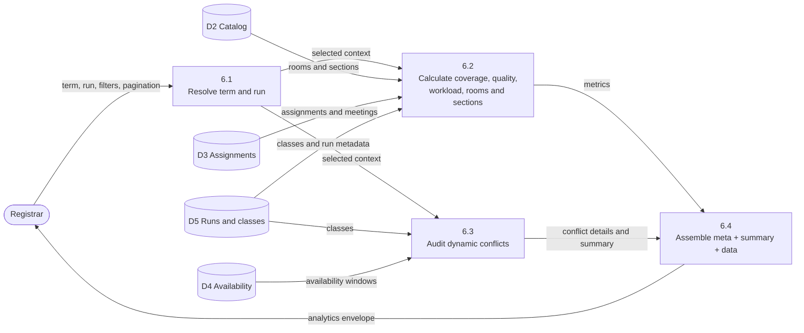

# Data Flow

This page contains the Context Flow Diagram (CFD), DFD Level 1, and selected
Level 2 decompositions. Data stores correspond to Django models; “cache” is the
Django cache used for import previews.

## Context Flow Diagram (CFD / DFD Level 0)

The CFD shows the system boundary and the external actors. It deliberately hides
internal processes and data stores.

### External data flows

| From | To | Data |
| --- | --- | --- |
| Registrar | System | Catalog records, assignments and meetings, import workbooks, settings changes, generation requests, publish requests |
| System | Registrar | Schedule runs and classes, dynamic conflicts, analytics, XLSX/PDF exports, settings, audit records |
| Professor | System | Availability windows and busy blocks |
| System | Professor | Professor profile, personal schedule, personal conflict report |
| Public | System | Term and section queries |
| System | Public | Published schedules only |
| Django administrator | System | Users, professor profiles, academic terms |
| System | Django administrator | Admin list/detail views and validation feedback |

## DFD Level 1

### Data stores

| Store | Underlying data | Written by | Read by |
| --- | --- | --- | --- |
| D1 Users and professor profiles | `auth.User`, `Professors` | Django admin, professor viewset | Auth, schedule builder, analytics |
| D2 Catalog | `Department`, `Room`, `Subject`, `Section` | Catalog viewsets, importer, Django admin | Scenario builder, analytics, import/export |
| D3 Academic terms, assignments, meetings | `AcademicTerm`, `Assignment`, `MeetingSlot` | Django admin, assignment endpoints, importer, demo command | Scenario builder, analytics, professor views |
| D4 Availability and busy blocks | `AvailabilityWindow`, `BusyBlock` | Professor/staff viewsets, importer, demo command | Scenario builder, conflict auditor, analytics |
| D5 Schedule runs and classes | `ScheduleRun`, `ScheduledClass` | Generation, publish endpoint, demo command | Review, public schedule, analytics, export |
| D6 Global settings | `GlobalSettings` | Settings endpoints, migration seed | Serializers, bulk assignment view, importer |
| D7 Audit log | `AuditLog` | External tooling / future instrumentation | Audit endpoint |
| D8 Conflict resolutions | `ConflictResolution` | External tooling / future instrumentation | Conflict-resolution endpoints |
| D9 Import-preview cache | Django cache entry `import_preview_<token>` | Import preview | Import commit |

## DFD Level 2 — Schedule generation (P4)

Generation is synchronous and wrapped in a database transaction for the run and
class writes. An invalid algorithm or missing active term stops before engine
execution.

## DFD Level 2 — Import preview and commit (P7)

The preview cache TTL is 900 seconds. With the default local-memory cache,
previews are process-local; a multi-process deployment needs a shared cache for
reliable commit behavior.

## DFD Level 2 — Analytics and conflict calculation (P6)

Analytics is read-only. The conflict auditor detects partial overlaps, capacity
violations, availability violations, consecutive-hour violations, and daily-hour
violations. It does not create `ConflictResolution` rows.

## Trust boundaries

- The public internet is untrusted; all registrar and professor operations require
  JWT authentication and role checks.
- Django admin is a staff-only trust boundary.
- Imported spreadsheets are untrusted input and are validated before commit.
- The scheduler receives validated in-memory data and is isolated from HTTP
  concerns.
- The configured database (SQLite in development; PostgreSQL planned for
  production) and Django secret key are deployment-sensitive assets.

See [Security](security.md) for controls and gaps.
