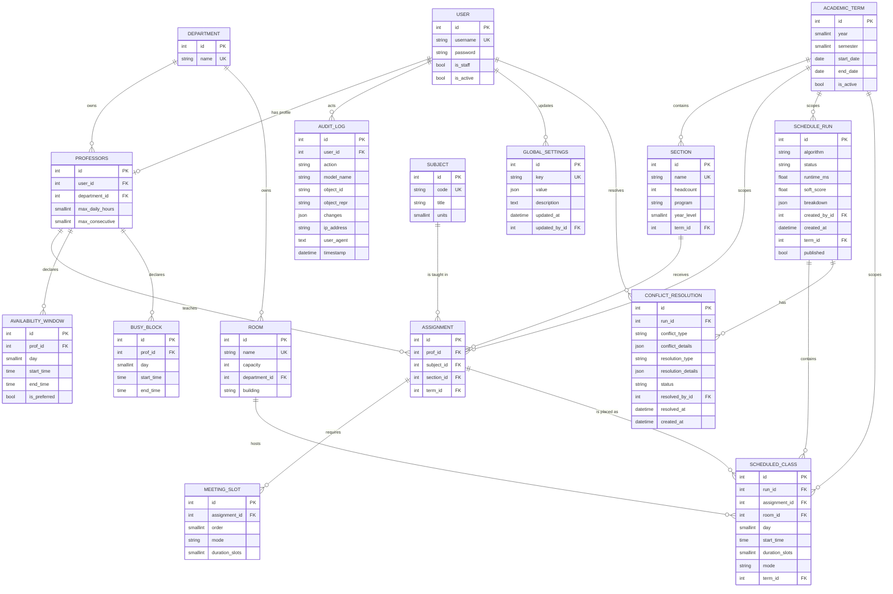

# Data Model

The model is split across three Django apps: `users`, `catalog`, and
`timetable`. The `data_transfer` app does not own persistent domain tables; it
reads and writes the models below.

## Entity-relationship diagram



## Data dictionary

### `users.Professors`

| Field | Type | Rules / notes |
| --- | --- | --- |
| `user` | OneToOne → `auth.User` | Cascade delete; related name `prof` |
| `department` | FK → `catalog.Department` | Nullable; `SET_NULL` |
| `max_daily_hours` | PositiveSmallInteger | Default `8` |
| `max_consecutive` | PositiveSmallInteger | Default `4` |

A user without a linked professor profile is not a professor for authorization
purposes. Staff users use registrar permissions instead.

### `catalog.Department`

| Field | Type | Rules / notes |
| --- | --- | --- |
| `name` | CharField(100) | Unique, required |

### `catalog.Room`

| Field | Type | Rules / notes |
| --- | --- | --- |
| `name` | CharField(50) | Unique, required |
| `capacity` | PositiveInteger | Required |
| `department` | FK → `Department` | Nullable; `SET_NULL`; unowned rooms are shared |
| `building` | CharField(100) | Blank allowed |

### `catalog.Subject`

| Field | Type | Rules / notes |
| --- | --- | --- |
| `code` | CharField(20) | Unique, required |
| `title` | CharField(200) | Required |
| `units` | PositiveSmallInteger | Default `3` |

Default ordering is by `code`.

### `catalog.Section`

| Field | Type | Rules / notes |
| --- | --- | --- |
| `name` | CharField(50) | Unique, required |
| `headcount` | PositiveInteger | Required; used for capacity checks |
| `program` | CharField(20) | Blank allowed; used for analytics grouping |
| `year_level` | PositiveSmallInteger | Default `1` |
| `term` | FK → `AcademicTerm` | Nullable; cascade delete |

### `timetable.AcademicTerm`

| Field | Type | Rules / notes |
| --- | --- | --- |
| `year` | PositiveSmallInteger | Required |
| `semester` | SmallInteger choices | `1` First, `2` Second |
| `start_date` | Date | Required |
| `end_date` | Date | Required |
| `is_active` | Boolean | Default `False`; generation uses the active term |

Unique together: `(year, semester)`. Default ordering is newest year and
semester first. `code` is a property in the form `YYYY-S`; `name` is a readable
label.

### `timetable.Assignment`

| Field | Type | Rules / notes |
| --- | --- | --- |
| `prof` | FK → `Professors` | Cascade delete |
| `subject` | FK → `Subject` | Cascade delete |
| `section` | FK → `Section` | Cascade delete |
| `term` | FK → `AcademicTerm` | Nullable; cascade delete |

Unique together: `(prof, subject, section, term)`. An assignment must have at
least one meeting at the serializer/API boundary.

### `timetable.MeetingSlot`

| Field | Type | Rules / notes |
| --- | --- | --- |
| `assignment` | FK → `Assignment` | Cascade delete; related name `meetings` |
| `order` | PositiveSmallInteger | Default `1` |
| `mode` | CharField choices | `async`, `sync`, `lab`; default `sync` |
| `duration_slots` | PositiveSmallInteger | Default `1`; check `>= 1` |

Unique together: `(assignment, order)`. Ordered by `order`. Durations are whole
hours. The configured mode defaults fill omitted values at the API boundary.

### `timetable.AvailabilityWindow`

| Field | Type | Rules / notes |
| --- | --- | --- |
| `prof` | FK → `Professors` | Cascade delete |
| `day` | SmallInteger | `0` Monday … `5` Saturday |
| `start_time` | Time | Required |
| `end_time` | Time | Required |
| `is_preferred` | Boolean | Default `False` |

Check: `start_time < end_time` and `0 <= day <= 5`. A professor may declare
multiple windows per day. Availability is treated as a hard constraint by the
engine.

### `timetable.BusyBlock`

| Field | Type | Rules / notes |
| --- | --- | --- |
| `prof` | FK → `Professors` | Cascade delete |
| `day` | SmallInteger | `0` Monday … `5` Saturday |
| `start_time` | Time | Required |
| `end_time` | Time | Required |

Check: `start_time < end_time` and `0 <= day <= 5`. Busy blocks are hard
constraints.

### `timetable.ScheduleRun`

| Field | Type | Rules / notes |
| --- | --- | --- |
| `algorithm` | CharField(50) | `greedy`, `min_conflicts`, or `backtracking` |
| `status` | CharField choices | `feasible`, `infeasible` |
| `runtime_ms` | Float | Default `0` |
| `soft_score` | Float | Nullable; lower is better |
| `breakdown` | JSON | Default empty object; contains scoring components |
| `created_by` | FK → `auth.User` | Nullable; `SET_NULL` |
| `created_at` | DateTime | Auto-added |
| `term` | FK → `AcademicTerm` | Nullable; cascade delete |
| `published` | Boolean | Default `False` |

Default ordering is newest first. Every generation attempt is persisted,
including infeasible attempts.

### `timetable.ScheduledClass`

| Field | Type | Rules / notes |
| --- | --- | --- |
| `run` | FK → `ScheduleRun` | Cascade delete; related name `classes` |
| `assignment` | FK → `Assignment` | Cascade delete |
| `room` | FK → `Room` | Nullable; `SET_NULL` |
| `day` | SmallInteger | `0` Monday … `5` Saturday |
| `start_time` | Time | Required |
| `duration_slots` | PositiveSmallInteger | Default `1`; check `>= 1` |
| `mode` | CharField choices | Nullable; `async`, `sync`, `lab` |
| `term` | FK → `AcademicTerm` | Nullable; cascade delete |

Check: `duration_slots >= 1` and `0 <= day <= 5`. `end_time` is a property that
adds `duration_slots` hours to `start_time`.

### `timetable.AuditLog`

| Field | Type | Rules / notes |
| --- | --- | --- |
| `user` | FK → `auth.User` | Nullable; `SET_NULL` |
| `action` | CharField choices | `create`, `update`, `delete`, `generate`, `publish`, `import`, `export`, `bulk_create`, `bulk_update` |
| `model_name` | CharField(50) | Affected model name |
| `object_id` | CharField(100) | Affected object ID |
| `object_repr` | CharField(200) | Human-readable representation |
| `changes` | JSON | Before/after or event data |
| `ip_address` | GenericIPAddressField | Nullable |
| `user_agent` | TextField | Blank allowed |
| `timestamp` | DateTime | Auto-added |

Indexes: `(user, -timestamp)`, `(model_name, object_id)`, and `(action,
-timestamp)`. **Known gap:** current business operations do not automatically
create audit rows.

### `timetable.GlobalSettings`

| Field | Type | Rules / notes |
| --- | --- | --- |
| `key` | CharField(100) | Unique, required |
| `value` | JSON | Any JSON value |
| `description` | TextField | Blank allowed |
| `updated_at` | DateTime | Auto-updated |
| `updated_by` | FK → `auth.User` | Nullable; `SET_NULL` |

Seeded duration keys: `async_duration_default` (1), `sync_duration_default` (2),
and `lab_duration_default` (3). Helpers validate positive, non-boolean integers.
The defaults only apply when a meeting omits `duration_slots`.

### `timetable.ConflictResolution`

| Field | Type | Rules / notes |
| --- | --- | --- |
| `run` | FK → `ScheduleRun` | Cascade delete; related name `conflict_resolutions` |
| `conflict_type` | CharField(50) | Type label |
| `conflict_details` | JSON | Conflict payload |
| `resolution_type` | CharField choices | `move_class`, `swap_rooms`, `swap_times`, `change_professor`, `split_class`, `manual` |
| `resolution_details` | JSON | Resolution payload |
| `status` | CharField choices | `pending`, `resolved`, `ignored` |
| `resolved_by` | FK → `auth.User` | Nullable; `SET_NULL` |
| `resolved_at` | DateTime | Nullable |
| `created_at` | DateTime | Auto-added |

Default ordering is newest first. **Known gap:** no current business operation
creates these rows automatically; analytics computes conflicts dynamically.

## Referential actions

| Parent | Child | On delete |
| --- | --- | --- |
| User | Professor profile | Cascade |
| Department | Professor / Room | Set null |
| AcademicTerm | Section / Assignment / ScheduleRun / ScheduledClass | Cascade |
| Professor | Assignment / AvailabilityWindow / BusyBlock | Cascade |
| Subject / Section | Assignment | Cascade |
| Assignment | MeetingSlot / ScheduledClass | Cascade |
| ScheduleRun | ScheduledClass / ConflictResolution | Cascade |
| Room | ScheduledClass | Set null |
| User | AuditLog / GlobalSettings / ConflictResolution | Set null |

## Lifecycle notes

### Schedule generation

```text
(no run) → feasible ──publish──▶ published
          └────────unpublish────▶ unpublished
(no run) → infeasible
```

A run's `published` flag is independent of feasibility. Publishing an infeasible
run is not blocked by the model, although registrars should review it first.

### Conflict resolution

```text
pending → resolved
pending → ignored
```

The transition is available through the resolve/ignore endpoints, but creation
is currently an external/future responsibility.

## Known data limitations

- No database constraint enforces a single active academic term.
- No `Student`, `Enrollment`, or `Program` model exists.
- No automatic retention policy or purge command for audit, run, or conflict
  history.
- `backend/db.sqlite3` is a development database artifact and must not be used
  as a production backup strategy; PostgreSQL is planned for production.
