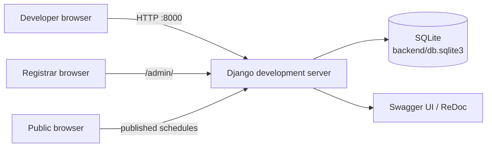
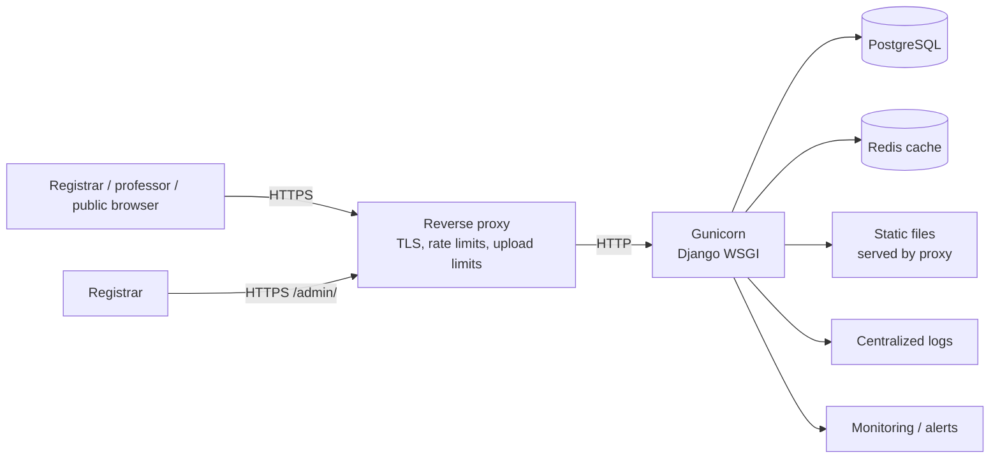

# Deployment

This page covers the current development deployment and a recommended production
topology. The repository currently contains a Django backend only; the React
frontend has not been scaffolded. The production topology below is guidance for
future deployment, not an implemented configuration.

## Current development deployment



### Prerequisites

- Python 3.14 (as documented by the backend README)
- `pip` and `venv`
- A POSIX-like shell; the documented commands use macOS/Linux paths

### First-time setup

```bash
git clone https://github.com/rkenbperez/Schedule-System.git
cd Schedule-System/backend

python3 -m venv .venv
source .venv/bin/activate
python -m pip install -r requirements.txt

python manage.py migrate
python manage.py createsuperuser
python manage.py runserver
```

The API is available at `http://127.0.0.1:8000/api/`. Interactive documentation:

- Swagger UI: `http://127.0.0.1:8000/api/schema/swagger-ui/`
- ReDoc: `http://127.0.0.1:8000/api/schema/redoc/`

### Demo dataset

Run the API server in one terminal and the demo command in another:

```bash
# terminal 1
python manage.py runserver

# terminal 2
cd backend
source .venv/bin/activate
python manage.py demo_schedule --reset
```

The demo creates a registrar, professors, catalog data, assignments, and three
schedule runs. It is development-only by default. See
[Operations](operations.md#demo-data) for the full workflow.

### Tests and checks

```bash
cd backend
python manage.py check
python manage.py makemigrations --check --dry-run
python manage.py test
```

Some legacy test modules currently contain pre-existing failures unrelated to
documentation changes. See [Testing](testing.md) for the current known failures
and targeted test commands.

### Schema generation

```bash
cd backend
python manage.py spectacular --file ../docs/api/openapi.yaml
```

Commit the regenerated `docs/api/openapi.yaml` whenever endpoint contracts
change.

## Recommended production topology

> **Status: Planned.** None of the production components below are configured in
> the repository. The current `settings.py` is development-oriented.



Recommended components:

| Concern | Recommendation |
| --- | --- |
| Application server | Gunicorn or uWSGI behind a reverse proxy; do not use `runserver` |
| Reverse proxy | Nginx, Caddy, or a managed load balancer with TLS |
| Database | PostgreSQL with automated backups and least-privilege credentials |
| Cache | Redis for import previews and future shared caching |
| Static files | `collectstatic` to a proxy-served directory or object storage |
| Secrets | Secret manager or environment variables; never commit them |
| Rate limiting | Proxy-level limits now; attach the application login throttle before launch |
| Uploads | Request-size and decompression limits at the proxy |
| Observability | Structured logs, health checks, error tracking, and database metrics |
| Backups | Encrypted database backups with restore testing |
| Access | Restrict `/admin/` by network or identity-aware proxy where possible |

## Production settings checklist

Before deployment:

- [ ] Set `DEBUG=False`.
- [ ] Move `SECRET_KEY` to an environment variable and rotate it.
- [ ] Set `ALLOWED_HOSTS` and trusted origins for the real hostnames.
- [ ] Configure TLS and redirect HTTP to HTTPS.
- [ ] Enable HSTS, secure cookies, and CSRF trusted origins as applicable.
- [ ] Attach the login throttle class or enforce login rate limits at the proxy.
- [ ] Replace SQLite with PostgreSQL.
- [ ] Configure a shared cache for import previews.
- [ ] Configure `STATIC_ROOT` and run `collectstatic`.
- [ ] Add CORS rules for the frontend origin.
- [ ] Add upload-size and decompression limits.
- [ ] Configure backups and test a restore.
- [ ] Verify `/api/schema/swagger-ui/` exposure is acceptable for the environment.
- [ ] Run `python manage.py check --deploy` and resolve the findings.

## Release and migration procedure

The repository uses Git tags and GitHub releases; see
[CONTRIBUTING.md](../CONTRIBUTING.md).

Recommended release flow:

1. Merge the release PR into `staging`.
2. Run `python manage.py check`, `makemigrations --check --dry-run`, and the
   test suite.
3. Regenerate `docs/api/openapi.yaml` if API contracts changed.
4. Back up the database.
5. Deploy the new code and run `python manage.py migrate --noinput`.
6. Run `python manage.py collectstatic --noinput` if static settings are used.
7. Restart the application workers.
8. Smoke-test login, schedule generation, analytics, import/export, and public
   schedules.
9. Tag the release and publish release notes.

## Rollback

- Keep the previous application artifact available.
- Database migrations are not automatically reversible in every case; verify the
  reverse migration before release.
- If a release must be rolled back, restore the database from the pre-release
  backup when schema changes are incompatible.
- Revoke or rotate secrets if a rollback is caused by credential exposure.

## Current deployment limitations

- No Dockerfile, container image, or infrastructure-as-code configuration.
- No CI/CD workflow.
- No health-check endpoint.
- No production database, cache, or static-file configuration.
- No frontend build or hosting configuration.
- No centralized logging, metrics, or alerting.
- No automated backup or restore process.

These are documented as gaps rather than implied capabilities.

## Related documentation

- [Configuration](configuration.md) — settings and environment variables
- [Security](security.md) — production checklist and threat model
- [Testing](testing.md) — test commands and known failures
- [Operations](operations.md) — demo, imports, exports, and troubleshooting
