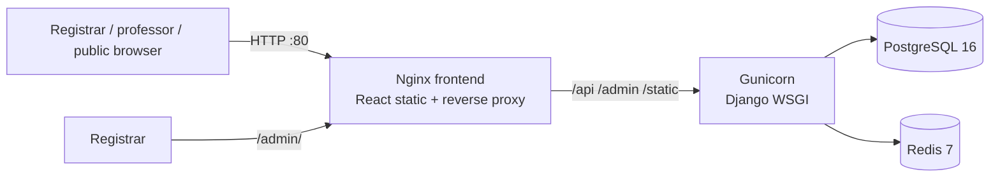

# Deployment

This page covers local development and the containerized production stack.
The repository ships a Docker Compose deployment with PostgreSQL, Redis,
Gunicorn, and an Nginx-served React build.

## Container topology (production)



Compose services:

| Service | Image / build | Role |
| --- | --- | --- |
| `db` | `postgres:16-alpine` | Primary database; data in the `postgres_data` volume |
| `redis` | `redis:7-alpine` | Shared cache (import previews, multiple workers) |
| `backend` | `./backend` | Gunicorn + WhiteNoise; runs migrations and `collectstatic` on start |
| `frontend` | `./client` | Multi-stage build; Nginx serves the SPA and proxies API paths |

Only the `frontend` service publishes a host port (`80` by default). The
database and Redis are reachable only on the internal Compose network.

## Quick start

Requirements: Docker Engine with the Compose plugin (or standalone
`docker-compose`).

```bash
cp .env.example .env
# Edit .env: set DJANGO_SECRET_KEY, POSTGRES_PASSWORD, and the hostnames.
docker compose up -d --build
```

The application is available at `http://localhost/`. Health check:

```bash
curl http://localhost/api/health/
```

Create the first administrator:

```bash
docker compose exec backend python manage.py createsuperuser
```

Then sign in at `http://localhost/admin/`. Academic terms and professor
profiles are managed through Django admin.

If your installation uses standalone Compose v1, replace `docker compose` with
`docker-compose` in the commands on this page.

## Configuration

Copy `.env.example` to `.env`; Compose reads it for interpolation. Every
`change-me` value must be replaced before deployment.

### Core

| Variable | Purpose | Default |
| --- | --- | --- |
| `POSTGRES_DB` | Database name | `scheduler` |
| `POSTGRES_USER` | Database role | `scheduler` |
| `POSTGRES_PASSWORD` | Database password | required |
| `DJANGO_SECRET_KEY` | Django signing key | required |
| `DJANGO_DEBUG` | Debug mode | `False` |
| `DJANGO_ALLOWED_HOSTS` | Comma-separated hosts | `localhost,127.0.0.1` |
| `DJANGO_CSRF_TRUSTED_ORIGINS` | Comma-separated origins | `http://localhost` |
| `CORS_ALLOWED_ORIGINS` | Comma-separated origins | `http://localhost` |
| `FRONTEND_URL` | Base URL used in emails | `http://localhost` |
| `HTTP_PORT` | Host port for Nginx | `80` |
| `VITE_API_URL` | API base baked into the SPA; empty means same-origin | empty |
| `REDIS_URL` | Django cache backend | `redis://redis:6379/1` |
| `GUNICORN_WORKERS` | Worker processes | `3` |
| `GUNICORN_TIMEOUT` | Worker timeout (seconds) | `300` |
| `SEED_DEMO_ADMIN` | Create `demo_admin` on migrate | `0` |
| `DJANGO_LOG_LEVEL` | Root log level | `INFO` |

`VITE_API_URL` is compiled into the frontend bundle. After changing it, rebuild
the frontend image:

```bash
docker compose build frontend
docker compose up -d frontend
```

### Email

Leave `EMAIL_HOST` empty to print password-reset emails to the backend logs.
Set `EMAIL_HOST`, `EMAIL_PORT`, `EMAIL_HOST_USER`, `EMAIL_HOST_PASSWORD`,
`EMAIL_USE_TLS`, and `DEFAULT_FROM_EMAIL` to use SMTP.

### Migrations and demo data

The backend entrypoint runs `migrate --noinput` and `collectstatic --noinput`
before starting Gunicorn. This is safe for a single backend replica. Before
scaling `backend` horizontally, move migrations to a dedicated one-shot job so
concurrent workers do not race.

The `0004_create_demo_admin` migration only creates the known `demo_admin`
account when `SEED_DEMO_ADMIN=1`. Keep it `0` on any shared or public
deployment.

## TLS with Certbot

The stack serves HTTP. Terminate TLS at a host-level reverse proxy and keep the
Compose frontend bound to loopback:

1. In `.env`, publish Nginx only on loopback, for example
   `HTTP_PORT=127.0.0.1:8080`.
2. Point a host Nginx `server` block for your domain at
   `http://127.0.0.1:8080`, forwarding `Host` and `X-Forwarded-*` headers.
3. Obtain a certificate with Certbot and enable it in the host proxy:

   ```bash
   sudo certbot --nginx -d schedule.example.com
   ```

4. Enable TLS-aware Django settings in `.env`:

   ```dotenv
   DJANGO_ALLOWED_HOSTS=schedule.example.com
   DJANGO_CSRF_TRUSTED_ORIGINS=https://schedule.example.com
   CORS_ALLOWED_ORIGINS=https://schedule.example.com
   FRONTEND_URL=https://schedule.example.com
   DJANGO_USE_X_FORWARDED_PROTO=True
   DJANGO_SECURE_SSL_REDIRECT=True
   DJANGO_SESSION_COOKIE_SECURE=True
   DJANGO_CSRF_COOKIE_SECURE=True
   DJANGO_SECURE_HSTS_SECONDS=31536000
   ```

5. Recreate the backend so the new environment applies:

   ```bash
   docker compose up -d backend
   ```

Certbot renews certificates through a system timer; reload the host proxy after
renewal (`systemctl reload nginx`).

## Backups and restore

Back up PostgreSQL from the running container:

```bash
docker compose exec -T db pg_dump \
  -U "${POSTGRES_USER:-scheduler}" \
  -d "${POSTGRES_DB:-scheduler}" \
  -Fc > "scheduler-$(date +%F).dump"
```

Restore into an empty or maintenance database:

```bash
cat scheduler-2026-11-28.dump | docker compose exec -T db pg_restore \
  -U "${POSTGRES_USER:-scheduler}" \
  -d "${POSTGRES_DB:-scheduler}" \
  --clean --if-exists
```

Operational guidance:

- Keep the application role least-privilege; use a separate role for backups.
- Compress and encrypt dumps, copy them offsite, and verify with
  `pg_restore --list`.
- Retain 7 daily, 4 weekly, and 3 monthly backups.
- Run a restore drill at least monthly. Target RPO ≤ 24 hours and RTO ≤ 1 hour
  until continuous WAL archiving or managed PITR is added.
- The Redis volume holds only cache data and does not need backup.

## Routine operations

```bash
docker compose ps                       # service status and health
docker compose logs -f backend          # application logs
docker compose logs -f frontend         # proxy logs
docker compose exec backend python manage.py check --deploy
docker compose exec backend python manage.py migrate --noinput
docker compose exec backend python manage.py collectstatic --noinput
```

Update to a new release:

```bash
git pull
docker compose build
docker compose up -d
```

The entrypoint applies migrations automatically. Back up the database first.

## Production checklist

- [ ] `DJANGO_DEBUG=False` and a unique `DJANGO_SECRET_KEY`.
- [ ] Strong `POSTGRES_PASSWORD`; database port stays unpublished.
- [ ] `DJANGO_ALLOWED_HOSTS`, `DJANGO_CSRF_TRUSTED_ORIGINS`, and
      `CORS_ALLOWED_ORIGINS` match the real hostnames.
- [ ] TLS terminated and HTTP redirected to HTTPS.
- [ ] Secure cookies and HSTS enabled after TLS works.
- [ ] `SEED_DEMO_ADMIN=0`.
- [ ] `python manage.py check --deploy` passes (or findings are understood).
- [ ] Login throttle is enforced (configured in DRF; verify at the proxy too).
- [ ] `/admin/` restricted by network or identity-aware proxy where possible.
- [ ] Backups configured, encrypted, offsite, and restore-tested.
- [ ] Logs, metrics, and alerting wired to the platform.
- [ ] Image and dependency vulnerability scans in the pipeline.

## Release and migration procedure

1. Merge the release PR into `staging`.
2. Run `python manage.py check`, `makemigrations --check --dry-run`, and the
   test suite.
3. Regenerate `docs/api/openapi.yaml` if API contracts changed.
4. Back up the database.
5. `docker compose build` and `docker compose up -d`.
6. Smoke-test login, schedule generation, analytics, import/export, and public
   schedules.
7. Tag the release and publish release notes.

## Rollback

- Keep the previous image or git revision available.
- Verify the reverse migration before release; not every migration is
  reversible.
- Restore the pre-release database backup when schema changes are incompatible.
- Rotate secrets if a rollback follows credential exposure.

## Current limitations

- No CI/CD workflow.
- No infrastructure-as-code or managed platform configuration.
- No centralized logging, metrics, or alerting bundled with the stack.
- No automated backup scheduler; use host cron or a managed database service.
- The stack serves HTTP; TLS requires a host-level proxy (see above).

## Related documentation

- [Configuration](configuration.md) — settings and environment variables
- [Security](security.md) — threat model and code-level gaps
- [Testing](testing.md) — test commands and current status
- [Operations](operations.md) — demo, imports, exports, and troubleshooting
