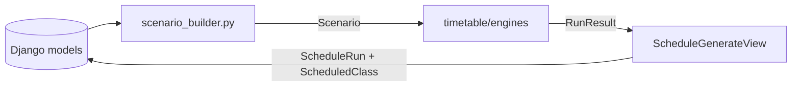

# Scheduling Engine

This page describes the pure-Python solver behind schedule generation. It is
intended for developers, maintainers, and reviewers who need to understand why
a run is feasible, how the three algorithms differ, and what the quality score
means.

Status: **Implemented**. The engine lives in `backend/timetable/engines/` and
has no Django imports.

## Responsibilities and boundaries

The engine receives a fully materialized `Scenario` and returns an `RunResult`.
It does not read the database, enforce authentication, or persist anything.



`backend/timetable/scenario_builder.py` is the only adapter between Django and
the engine. It selects assignments for one academic term, expands each
`MeetingSlot` into an engine `Meeting`, and loads rooms, availability windows,
busy blocks, and professor limits.

## Input model

| Dataclass | Purpose |
| --- | --- |
| `RoomRef` | Room ID, name, capacity, department, building |
| `Meeting` | One weekly meeting: assignment, professor, section, headcount, duration, department, mode |
| `Availability` | Professor availability window, including the `is_preferred` flag |
| `Busy` | Professor busy block |
| `Scenario` | Rooms, meetings, availability, busy blocks, limits, day ranges, slot size |
| `Placement` | A meeting assigned to a day, start minute, and room |
| `PlacedClass` | Engine output row derived from a placement |
| `RunResult` | Feasibility, runtime, soft score, classes, violations, unplaced meetings, breakdown |

The builder uses the **active academic term only**. Assignments in other terms
are not sent to the engine. Availability windows and busy blocks are loaded for
professors who have assignments in that term. Rooms are not term-scoped, so all
rooms are available to the solver.

## Time model

- Times are represented as **minutes since midnight**.
- The default slot size is **60 minutes** (`SLOT_MINUTES`).
- Default opening hours (`DEFAULT_DAY_RANGES`):

| Day | Opening hours | Available hours |
| --- | --- | --- |
| Monday–Friday | 07:00–19:00 | 12 each |
| Saturday | 07:00–13:00 | 6 |
| **Week total** | | **66** |

A meeting of `duration_slots = 2` occupies two consecutive one-hour slots. A
placement is legal only if the whole meeting fits inside opening hours and is
aligned to the slot grid.

## Hard constraints

`hard_violations()` checks the complete schedule after an algorithm finishes.
A run is **feasible only when this list is empty**.

| Constraint | Rule |
| --- | --- |
| Complete placement | Every meeting in the scenario must be placed |
| Known day | Day must be an integer from 0 (Monday) to 5 (Saturday) |
| Professor overlap | One professor cannot teach two overlapping meetings |
| Section overlap | One section cannot attend two overlapping meetings |
| Room overlap | One room cannot host two overlapping meetings |
| Grid alignment | Start time must align to the slot grid |
| Opening hours | The whole class must fit inside the day's opening hours |
| Room assignment | Every placed class must have a room |
| Department scope | A room's department and the professor's department must match, unless either is blank |
| Capacity | Room capacity must be at least the section headcount |
| Availability | The complete class must fit inside at least one of the professor's availability windows for that day |
| Busy block | A class cannot overlap any of the professor's busy blocks |
| Daily hours | A professor's scheduled minutes on a day cannot exceed `max_daily_hours` |
| Consecutive hours | A professor's longest unbroken teaching run cannot exceed `max_consecutive` |

The engine's fallback limits are 8 daily hours and 3 consecutive hours when a
scenario does not provide professor-specific values. The `Professors` model
defaults are 8 daily hours and **4** consecutive hours, and the scenario builder
supplies those values for assigned professors.

Overlap checks use interval arithmetic, so a two-hour class starting at 09:00
conflicts with a one-hour class starting at 10:00, not only with one that starts
at exactly 09:00.

The API persists infeasible runs as well as feasible ones. The response lists
human-readable `violations` and numeric `unplaced` meeting IDs, but those two
fields are not stored on `ScheduleRun`.

## Soft score

Feasible schedules receive a `soft_score`. **Lower is better.** Infeasible runs
receive `soft_score = null`; the engine does not score a schedule that breaks a
hard rule.

| Component | Weight | Calculation |
| --- | --- | --- |
| `spread` | 10 | For each professor, measure the variance of scheduled hours across the six days; sum the variances |
| `consecutive` | 2 | Count adjacent occupied hour pairs per professor and day |
| `preferred` | 5 | Count meetings not fully inside a window marked `is_preferred` |

```text
soft_score = 10 × spread + 2 × consecutive + 5 × preferred
```

The breakdown returned by the engine has the keys `spread`, `consecutive`,
`preferred`, and `total`. `ScheduleRun.breakdown` stores this object. Because
all algorithms use the same scorer, runs on the same scenario and term can be
compared directly by `runtime_ms` and `soft_score`.

## Algorithms

### Greedy

`greedy` orders meetings by how constrained they are under an empty schedule:
the fewest legal time slots first, then the longest duration. It places each
meeting in its first legal time slot with the smallest-capacity free room.

- Fast and deterministic.
- Never backtracks or repairs an earlier choice.
- Can leave meetings unplaced even when a valid complete schedule exists.

### Min-conflicts

`min_conflicts` starts with a complete random assignment, then repairs it.

1. Build an initial placement for every meeting using legal time slots and
   legal rooms.
2. Find meetings involved in at least one hard violation or overlap.
3. Pick one conflicted meeting at random.
4. Evaluate every legal slot and room for that meeting, scoring the candidate by
   overlap conflicts plus remaining hard violations.
5. Move to a best candidate, breaking ties randomly.
6. Repeat until no conflicted meetings remain or a limit is reached.

Limits are 20,000 iterations and the request's `time_limit_s`. Randomness is
seeded with `seed=0` by default, which makes runs reproducible for the same
input and code version. The API does not expose the seed.

### Backtracking

`backtracking` is a depth-first constraint search.

- Selects the unplaced meeting with the fewest legal candidates
  (most-constrained-variable ordering).
- Forward-checks that a free, large-enough room exists before trying a time
  slot.
- Tries candidates recursively and undoes a choice when a branch fails.
- Returns the first complete solution found; if time expires, returns the best
  partial placement found so far.

It can prove feasibility or infeasibility on small instances, but its search
space grows quickly. The time limit is the practical protection for larger
inputs.

## Runner behaviour

`runner.run()` performs the shared post-processing for every algorithm:

1. Reject an unknown algorithm.
2. Measure wall-clock runtime with `time.monotonic()`.
3. Run the selected engine with the time limit.
4. Compute hard violations and feasibility.
5. Build sorted `PlacedClass` rows for the placed meetings.
6. Compute the soft score only when feasible.
7. Return unplaced meeting IDs and the score breakdown.

`ScheduleGenerateView` wraps persistence in `transaction.atomic()` and creates
one `ScheduleRun` plus its `ScheduledClass` rows. The response includes
`run_id`, `status`, `feasible`, `runtime_ms`, `soft_score`, `class_count`,
`violations`, and `unplaced`.

## Algorithm comparison

| Property | Greedy | Min-conflicts | Backtracking |
| --- | --- | --- | --- |
| Strategy | Constructive | Local search / repair | Complete search with pruning |
| Backtracks | No | No | Yes |
| Deterministic | Yes | Yes with fixed seed | Yes |
| Can leave meetings unplaced | Yes | Yes if limits are reached | Yes on timeout |
| Typical strength | Speed | Improving a rough assignment | Finding a solution on constrained instances |
| Typical weakness | Dead ends | Local minima and iteration limits | Search time on large instances |
| Soft score | Computed if feasible | Computed if feasible | Computed if feasible |

No algorithm guarantees the lowest possible `soft_score`; the score is a shared
comparison measure, not a proof of optimality. `backtracking` guarantees a
complete solution only when it finishes its search within the time limit.

## Limits and failure modes

| Situation | Behaviour |
| --- | --- |
| Unknown algorithm | API returns HTTP 400 |
| No active term | API returns HTTP 400 |
| Non-numeric `time_limit_s` | API returns HTTP 400 |
| Time limit reached | Engine returns its best partial result |
| No legal room or slot | Meeting remains unplaced; run is infeasible |
| More than one hard issue | All violations are collected in the response |
| Large dataset | Runtime grows with meetings, slots, and rooms; use the time limit and compare engines |

The default `time_limit_s` is 30 seconds. Setting it very low can produce
unplaced meetings even when a solution exists. The scalability tests exercise
large synthetic instances; they are evidence of practical behavior, not a
formal performance guarantee.

## Extending the engine

To add an algorithm:

1. Implement a function that accepts `Scenario` and `time_limit_s` and returns a
   `dict[meeting_id, Placement]`.
2. Register it in `ALGORITHMS` in `backend/timetable/engines/runner.py`.
3. Reuse `hard_violations()` and do not duplicate scoring logic.
4. Add engine tests that cover a feasible case, an infeasible case, and a case
   where the algorithm differs from the existing ones.
5. Update this page and the API reference if request fields change.

## Related documentation

- [Architecture](architecture.md) — where the engine sits in the system
- [Data model](data-model.md) — source records for scenarios
- [API reference](api-reference.md) — generation request and response
- [Testing](testing.md) — engine and scalability tests
- `backend/timetable/engines/` — source code
- `backend/timetable/scenario_builder.py` — database-to-engine adapter
