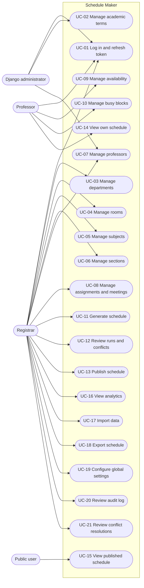

# Use Cases

This page describes the human actors and the workflows supported by the
implemented system. It is the behavioral companion to
[Requirements](requirements.md) and [API reference](api-reference.md).

## Actors

| Actor | Type | Responsibilities |
| --- | --- | --- |
| Registrar | Primary, authenticated staff | Maintain catalog and assignments, configure settings, generate, review, publish, import/export, and analyze schedules |
| Professor | Primary, authenticated non-staff | Maintain personal availability and busy blocks; view own schedule and conflicts |
| Public user | Primary, anonymous | Browse published terms and view published schedules |
| Django administrator | Supporting, staff | Manage users, professor profiles, and academic terms through Django admin |
| Scheduler | System | Build a scenario from the database, run an algorithm, and return placed classes and violations |

## Use-case diagram

## Use-case catalog

| ID | Name | Primary actor | Goal | Related requirements |
| --- | --- | --- | --- | --- |
| UC-01 | Log in and refresh token | Registrar, Professor, Administrator | Obtain and maintain an authenticated session | FR-AUTH-01…04 |
| UC-02 | Manage academic terms | Django administrator | Create and activate terms | FR-TERM-01…05 |
| UC-03 | Manage departments | Registrar | Define organizational ownership | FR-CAT-01, FR-CAT-02 |
| UC-04 | Manage rooms | Registrar | Define teaching spaces and capacity | FR-CAT-01, FR-CAT-04 |
| UC-05 | Manage subjects | Registrar | Define subject codes, titles, and units | FR-CAT-01, FR-CAT-02 |
| UC-06 | Manage sections | Registrar | Define class groups and headcounts | FR-CAT-01…03 |
| UC-07 | Manage professors | Registrar, Administrator | Create professor profiles and limits | FR-PROF-01…04 |
| UC-08 | Manage assignments and meetings | Registrar | Define teaching loads with weekly meetings | FR-ASG-01…10 |
| UC-09 | Manage availability | Professor | State when teaching is possible | FR-PROF-03 |
| UC-10 | Manage busy blocks | Professor | Block already-occupied time | FR-PROF-03 |
| UC-11 | Generate schedule | Registrar | Produce a timetable run | FR-SCH-01…06 |
| UC-12 | Review runs and conflicts | Registrar | Compare runs and inspect violations | FR-SCH-07, FR-SCH-08 |
| UC-13 | Publish schedule | Registrar | Make a run visible publicly | FR-SCH-09 |
| UC-14 | View own schedule | Professor | See personal teaching timetable | FR-SCH-10 |
| UC-15 | View published schedule | Public user | Read a published term/section timetable | FR-AUTH-08, FR-SCH-09 |
| UC-16 | View analytics | Registrar | Measure coverage, workload, rooms, sections, quality | FR-SCH-11 |
| UC-17 | Import data | Registrar | Load catalog and assignments from a spreadsheet | FR-DATA-01…03 |
| UC-18 | Export schedule | Registrar | Download a run as XLSX or PDF | FR-DATA-04 |
| UC-19 | Configure global settings | Registrar | Change mode default durations and other settings | FR-DATA-07, FR-DATA-08, FR-ASG-09 |
| UC-20 | Review audit log | Registrar | Inspect recorded actions | FR-DATA-05, FR-DATA-06 |
| UC-21 | Review conflict resolutions | Registrar | Track resolution records | FR-DATA-09, FR-DATA-10 |

## Detailed scenarios

### UC-01 — Log in and refresh token

**Primary actor:** Registrar, professor, or administrator  
**Preconditions:** An active user account exists.  
**Trigger:** The client submits credentials.

**Main flow**

1. The client sends `POST /api/auth/jwt/login/` with a username and password.
2. The API validates the credentials and returns an `access` token and a
   `refresh` token.
3. The client sends the access token as `Authorization: Bearer <token>` on
   protected requests.
4. The client may call `GET /api/auth/jwt/me/` to read the user's role profile.

**Alternative flows**

- Invalid credentials return `401`.
- If login throttling is enabled (currently a known gap), too many attempts may
  return `429`. The `LoginRateThrottle` class exists but is not attached to the
  login view.
- An expired access token is refreshed with `POST /api/auth/jwt/refresh/`.
- Logout sends the refresh token to `POST /api/auth/jwt/logout/`, which
  blacklists it.

**Postconditions:** The client holds a valid access token or has ended the
refresh-token session.

### UC-02 — Manage academic terms

**Primary actor:** Django administrator  
**Preconditions:** Staff access to Django admin.  
**Main flow:** Create a term with year, semester, dates, and active flag; activate
the term that scheduling should use.  
**Alternative flow:** More than one term can technically be marked active because
the database does not enforce a single active term. Operators must ensure only
one is active.  
**Postconditions:** A term exists and can be referenced by sections and
assignments. The API does not expose a term CRUD endpoint.

### UC-08 — Manage assignments and meetings

**Primary actor:** Registrar  
**Preconditions:** Professor, subject, section, and term exist.  
**Trigger:** The registrar creates or updates an assignment.

**Main flow**

1. The registrar sends an assignment with professor, subject, section, term, and
   a non-empty `meetings` list.
2. Each meeting supplies a mode (`async`, `sync`, or `lab`). If
   `duration_slots` is omitted, the configured default for that mode is used.
3. The API validates the payload, including the requirement that at least one
   meeting is `sync` or `lab`.
4. The assignment and its meeting slots are saved.

**Alternative flows**

- An assignment with no meetings or only asynchronous meetings is rejected with
  `400`.
- A mode outside the supported choices or a duration below one is rejected.
- A duplicate professor/subject/section/term combination is rejected.
- A single assignment creation can be replaced by the bulk endpoint
  `/api/admin/assignments/bulk/`.

**Postconditions:** The assignment contributes its meetings to the next
scenario build.

### UC-09 / UC-10 — Manage availability and busy blocks

**Primary actor:** Professor  
**Preconditions:** The authenticated user has a linked professor profile.  
**Main flow**

1. The professor creates, lists, updates, or deletes availability windows at
   `/api/professor/availability/`.
2. Each window has a day, start time, end time, and optional preferred flag.
3. The professor manages fixed commitments at
   `/api/professor/busy-blocks/`.

**Alternative flows**

- A range whose end is not after its start is rejected.
- A day outside Monday-Saturday is rejected.
- A professor cannot modify another professor's records; registrars retain
  access through the staff endpoints.

**Postconditions:** The next generated schedule honors availability and busy
blocks as hard constraints.

### UC-11 — Generate schedule

**Primary actor:** Registrar  
**Preconditions:** An active term exists; assignments and meetings exist; rooms
exist.  
**Trigger:** `POST /api/schedules/generate`.

**Main flow**

1. The registrar selects `greedy`, `min_conflicts`, or `backtracking` and
   optionally a time limit.
2. The API loads the active term's assignments, meetings, availability, busy
   blocks, rooms, and professor limits.
3. The scenario builder converts the rows into pure-Python engine input.
4. The selected engine places classes and returns the result.
5. The API persists a `ScheduleRun` and its `ScheduledClass` rows in a
   transaction.
6. The response returns `run_id`, `status`, `feasible`, runtime, soft score,
   class count, violations, and unplaced meetings.

**Alternative flows**

- An unknown algorithm or a non-numeric time limit returns `400`.
- No active term returns `400`.
- An infeasible result is still persisted, with status `infeasible` and the
  violations/unplaced data returned for review.
- A long run can exceed the client's timeout because generation is synchronous.

**Postconditions:** A new schedule run is available for review.

### UC-12 / UC-13 — Review and publish schedule

**Primary actor:** Registrar  
**Preconditions:** A schedule run exists.  
**Main flow**

1. The registrar lists runs at `/api/schedules/runs` and inspects a run's
   classes.
2. The registrar inspects dynamically calculated conflicts at
   `/api/admin/schedules/runs/<id>/conflicts/`.
3. The registrar publishes or unpublishes the run with
   `PATCH /api/admin/schedules/runs/<id>/publish/` and a boolean `published`
   field.
4. Public clients can then read the published schedule.

**Alternative flows**

- Publishing without `published` returns `400`.
- Non-staff users cannot publish.
- Unpublished runs are not visible through public endpoints.

**Postconditions:** The run's public visibility matches the registrar's choice.

### UC-14 / UC-15 — View schedules

**Primary actor:** Professor or public user  
**Main flow**

- A professor reads `/api/schedules/my` or
  `/api/professor/me/schedule/` and sees only their own classes.
- A professor can inspect personal conflicts at
  `/api/professor/me/schedule/conflicts/`.
- A public user lists available published terms and reads
  `/api/public/schedules/<term_code>/` or a section-specific URL.

**Alternative flows**

- An account without a professor profile receives `400` from the personal
  schedule endpoint.
- A term or section with no published run returns an empty or not-found result
  according to the endpoint.

### UC-16 — View analytics

**Primary actor:** Registrar  
**Preconditions:** Registrar authentication.  
**Main flow**

1. The registrar calls overview, quality, workload, rooms, or sections
   analytics.
2. The analytics layer selects a term and run using explicit parameters or the
   default order: latest published, latest feasible, latest.
3. Metrics are calculated from term assignments, scheduled classes, rooms,
   availability, and the shared conflict auditor.
4. The response returns `meta`, `summary`, and `data`.

**Alternative flows**

- A run that does not belong to the selected term returns `400`.
- An unknown term or run returns `400`.
- Invalid pagination, status, or date filters return `400`.
- If no active term and no runs exist, empty summaries are returned.

**Postconditions:** No data is changed.

### UC-17 / UC-18 — Import and export

**Primary actor:** Registrar  
**Main flow**

1. The registrar downloads an XLSX or CSV template.
2. The registrar uploads a workbook to `/api/imports/preview/`.
3. The API validates sheets and returns a preview token, summary, details, and
   errors.
4. The registrar posts the token to `/api/imports/commit/` to apply the data.
5. The registrar downloads a schedule run as XLSX or PDF from
   `/api/exports/schedules/<id>.xlsx` or `.pdf`.

**Alternative flows**

- Validation errors stop the commit.
- An invalid or expired preview token is rejected.
- Export requires the run to exist and the caller to satisfy the endpoint's
  permission rules.

### UC-19 — Configure global settings

**Primary actor:** Registrar  
**Main flow**

1. The registrar lists settings or reads one by key.
2. The registrar updates `async_duration_default`,
   `sync_duration_default`, or `lab_duration_default`.
3. The API validates that the value is a positive, non-boolean integer.
4. Future meetings that omit a duration use the new value; existing meetings are
   unchanged.

**Alternative flows**

- A non-integer or zero value returns `400`.
- Bulk updates report per-setting errors in the response.

### UC-20 / UC-21 — Audit and conflict records

**Primary actor:** Registrar  
**Known gaps:** The read and update surfaces exist, but current business
operations do not automatically create `AuditLog` or `ConflictResolution` rows.
The audit page and conflict-resolution endpoints therefore reflect only records
inserted by external tooling or future instrumentation. Analytics conflicts are
calculated live and do not depend on `ConflictResolution` records.
