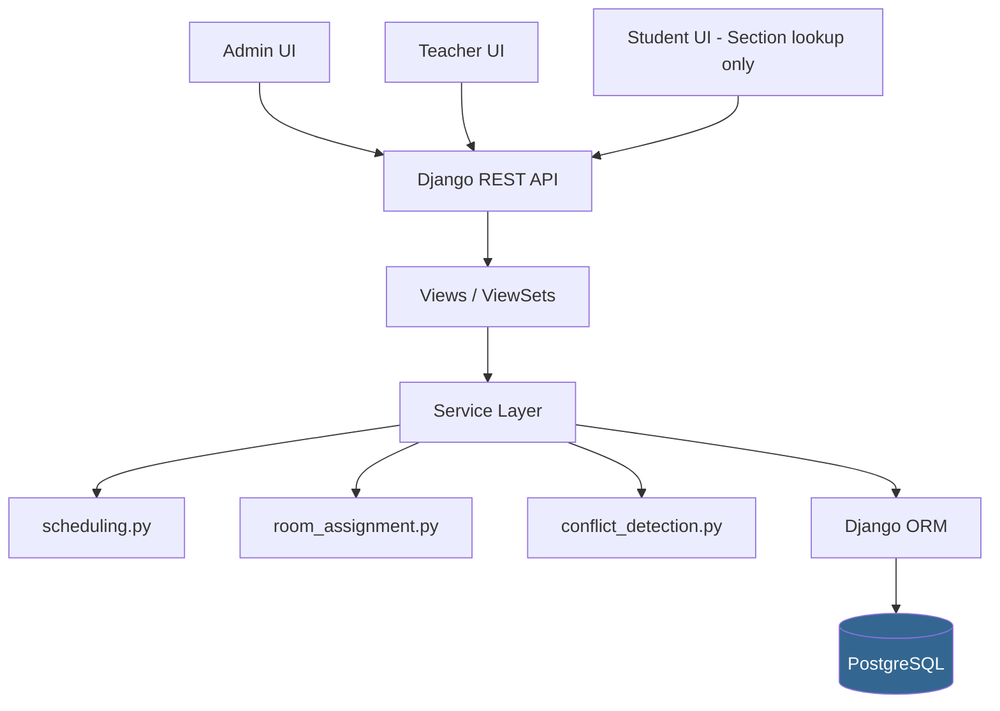
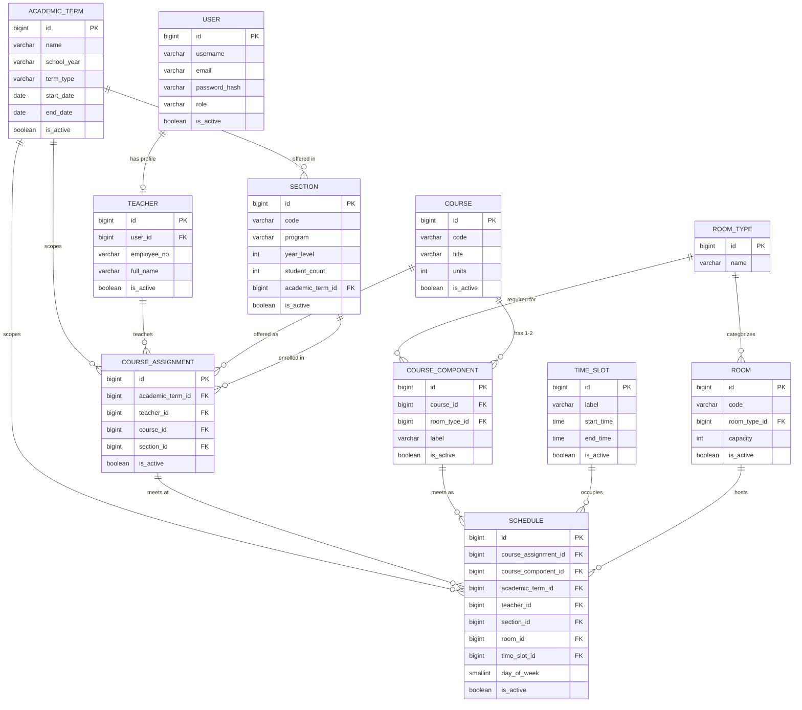
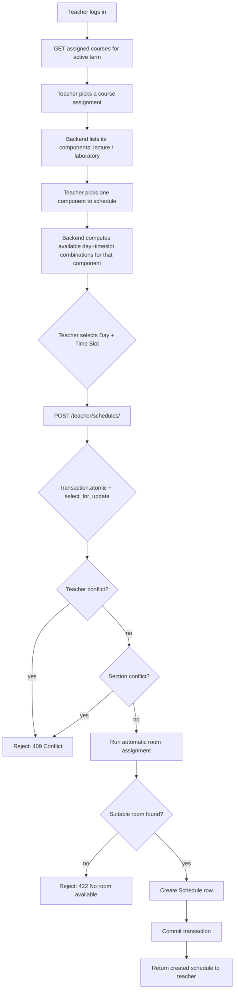
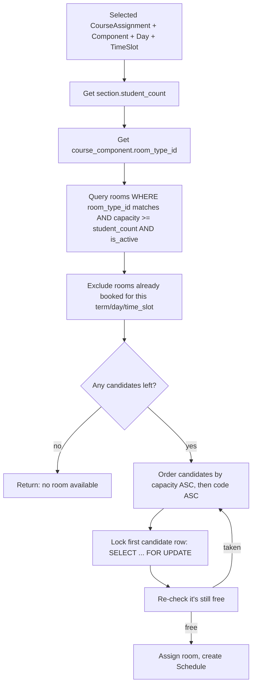

# University Teacher Scheduling System — Flow Diagrams & PostgreSQL Design

## 0. Assumptions (please confirm before building on top of this)

1. **Confirmed:** some courses (COSC and select science courses in other departments) need both a lecture _and_ a laboratory meeting per week, each with its own room type, day, time, and possibly room capacity requirement. This is modeled directly with a `course_components` table (not deferred as before) — a course has 1–2 components, and every schedule row belongs to a specific component, not just the course.
2. **Students have no login** — section-code lookup only, exactly as you described.
3. **One teacher per (course, section) per academic term.** Co-teaching / team-teaching is out of scope unless you say otherwise.
4. **Time slots are fixed, reusable labels** (7–10, 10–1, 1–3, 3–6), the same set every weekday. The schema is built so this can evolve into arbitrary time ranges with PostgreSQL exclusion constraints without restructuring the tables.
5. A **Section** is a fixed group of students (e.g. "3-A") that takes several courses in a term — not created per-course.
6. Historical schedules are never deleted, only scoped by `academic_term_id` and optionally soft-deactivated.

---

## 1. System Architecture



---

## 2. Database ERD



**Why `teacher_id`, `section_id`, `academic_term_id` are duplicated onto `schedule`:** they're technically derivable through `course_assignment`, but PostgreSQL `UNIQUE` constraints (and any future `EXCLUDE` constraint) can only see columns physically on the row being checked. Denormalizing these three FKs onto `schedule` is what lets the database — not just application code — reject teacher/section double-bookings at the constraint level. They're kept in sync via the service layer inside `transaction.atomic()` (details in the concurrency phase, next).

**Why `schedule` points to `course_component`, not just `course_assignment`:** a course assignment now represents "this teacher teaches this course to this section" — it doesn't say _which_ meeting. Since a course can have a lecture component and a lab component with different room-type requirements, different days, and even different rooms, each `schedule` row has to know exactly which component it's satisfying so the room-type/capacity validation checks the right requirement.

---

## 3. Teacher Scheduling Flow



---

## 4. Automatic Room Assignment Flow



**Room ranking rule:** smallest capacity that still fits, so a 30-capacity lab isn't burned on a 15-student section when a 20-capacity lab is free. Tie-break by room code for determinism (helps testing and avoids "random" assignment complaints from admins).

---

## 5. PostgreSQL Schema (DDL)

```sql
-- Extension needed if you later move to real time-ranges + exclusion constraints
-- CREATE EXTENSION IF NOT EXISTS btree_gist;

CREATE TABLE users (
    id              BIGSERIAL PRIMARY KEY,
    username        VARCHAR(150) NOT NULL UNIQUE,
    email           VARCHAR(255) NOT NULL UNIQUE,
    password_hash   VARCHAR(255) NOT NULL,
    role            VARCHAR(20)  NOT NULL CHECK (role IN ('admin', 'teacher')),
    is_active       BOOLEAN NOT NULL DEFAULT TRUE,
    created_at      TIMESTAMPTZ NOT NULL DEFAULT now(),
    updated_at      TIMESTAMPTZ NOT NULL DEFAULT now()
);

CREATE TABLE teachers (
    id              BIGSERIAL PRIMARY KEY,
    user_id         BIGINT NOT NULL UNIQUE REFERENCES users(id) ON DELETE CASCADE,
    employee_no     VARCHAR(50) NOT NULL UNIQUE,
    full_name       VARCHAR(255) NOT NULL,
    is_active       BOOLEAN NOT NULL DEFAULT TRUE,
    created_at      TIMESTAMPTZ NOT NULL DEFAULT now(),
    updated_at      TIMESTAMPTZ NOT NULL DEFAULT now()
);
-- one-to-one: a user account maps to at most one teacher profile

CREATE TABLE academic_terms (
    id              BIGSERIAL PRIMARY KEY,
    name            VARCHAR(100) NOT NULL,          -- "1st Semester"
    school_year     VARCHAR(20)  NOT NULL,           -- "2026-2027"
    term_type       VARCHAR(20)  NOT NULL DEFAULT 'regular',
    start_date      DATE NOT NULL,
    end_date        DATE NOT NULL,
    is_active       BOOLEAN NOT NULL DEFAULT FALSE,  -- only one should be "current"
    created_at      TIMESTAMPTZ NOT NULL DEFAULT now(),
    CONSTRAINT chk_term_dates CHECK (end_date > start_date),
    CONSTRAINT uq_term UNIQUE (school_year, name)
);
-- Partial unique index enforcing only ONE active term at a time
CREATE UNIQUE INDEX uq_one_active_term ON academic_terms (is_active) WHERE is_active = TRUE;

CREATE TABLE room_types (
    id      BIGSERIAL PRIMARY KEY,
    name    VARCHAR(50) NOT NULL UNIQUE   -- 'Lecture', 'Laboratory'
);

CREATE TABLE rooms (
    id              BIGSERIAL PRIMARY KEY,
    code            VARCHAR(50) NOT NULL UNIQUE,     -- "Room 101", "Lab 202"
    room_type_id    BIGINT NOT NULL REFERENCES room_types(id) ON DELETE RESTRICT,
    capacity        INTEGER NOT NULL CHECK (capacity > 0),
    is_active       BOOLEAN NOT NULL DEFAULT TRUE,
    created_at      TIMESTAMPTZ NOT NULL DEFAULT now()
);
CREATE INDEX idx_rooms_type_capacity ON rooms (room_type_id, capacity) WHERE is_active = TRUE;

CREATE TABLE courses (
    id              BIGSERIAL PRIMARY KEY,
    code            VARCHAR(50) NOT NULL UNIQUE,     -- "COSC 7", "DCIT 5"
    title           VARCHAR(255) NOT NULL,
    units           NUMERIC(3,1) NOT NULL DEFAULT 3.0,
    is_active       BOOLEAN NOT NULL DEFAULT TRUE,
    created_at      TIMESTAMPTZ NOT NULL DEFAULT now()
);

-- A course has 1 or 2 components. Pure-lecture courses (GNED 12) get one row
-- with label='lecture'. Courses needing both (COSC 7, some science courses)
-- get two rows: one 'lecture' + one 'laboratory', each with its own room type.
CREATE TABLE course_components (
    id              BIGSERIAL PRIMARY KEY,
    course_id       BIGINT NOT NULL REFERENCES courses(id) ON DELETE CASCADE,
    room_type_id    BIGINT NOT NULL REFERENCES room_types(id) ON DELETE RESTRICT,
    label           VARCHAR(20) NOT NULL CHECK (label IN ('lecture', 'laboratory')),
    is_active       BOOLEAN NOT NULL DEFAULT TRUE,
    created_at      TIMESTAMPTZ NOT NULL DEFAULT now(),
    -- a course can't have two "lecture" components or two "laboratory" components
    CONSTRAINT uq_course_component_label UNIQUE (course_id, label)
);
CREATE INDEX idx_components_course ON course_components (course_id) WHERE is_active = TRUE;

CREATE TABLE sections (
    id                  BIGSERIAL PRIMARY KEY,
    code                VARCHAR(20) NOT NULL,        -- "3-A"
    program             VARCHAR(50),
    year_level          SMALLINT,
    student_count       INTEGER NOT NULL CHECK (student_count >= 0),
    academic_term_id    BIGINT NOT NULL REFERENCES academic_terms(id) ON DELETE RESTRICT,
    is_active           BOOLEAN NOT NULL DEFAULT TRUE,
    created_at          TIMESTAMPTZ NOT NULL DEFAULT now(),
    CONSTRAINT uq_section_per_term UNIQUE (academic_term_id, code)
);

CREATE TABLE time_slots (
    id          BIGSERIAL PRIMARY KEY,
    label       VARCHAR(50) NOT NULL,        -- "7:00 AM - 10:00 AM"
    start_time  TIME NOT NULL,
    end_time    TIME NOT NULL,
    is_active   BOOLEAN NOT NULL DEFAULT TRUE,
    CONSTRAINT chk_slot_time CHECK (end_time > start_time),
    CONSTRAINT uq_slot_range UNIQUE (start_time, end_time)
);

CREATE TABLE course_assignments (
    id                  BIGSERIAL PRIMARY KEY,
    academic_term_id    BIGINT NOT NULL REFERENCES academic_terms(id) ON DELETE RESTRICT,
    teacher_id          BIGINT NOT NULL REFERENCES teachers(id) ON DELETE RESTRICT,
    course_id           BIGINT NOT NULL REFERENCES courses(id) ON DELETE RESTRICT,
    section_id          BIGINT NOT NULL REFERENCES sections(id) ON DELETE RESTRICT,
    is_active           BOOLEAN NOT NULL DEFAULT TRUE,
    created_at          TIMESTAMPTZ NOT NULL DEFAULT now(),
    -- one teacher per (course, section) per term
    CONSTRAINT uq_course_section_per_term UNIQUE (academic_term_id, course_id, section_id)
);
CREATE INDEX idx_ca_teacher_term ON course_assignments (teacher_id, academic_term_id);
CREATE INDEX idx_ca_section_term ON course_assignments (section_id, academic_term_id);

CREATE TABLE schedules (
    id                      BIGSERIAL PRIMARY KEY,
    course_assignment_id    BIGINT NOT NULL REFERENCES course_assignments(id) ON DELETE CASCADE,
    course_component_id     BIGINT NOT NULL REFERENCES course_components(id) ON DELETE RESTRICT,
    -- denormalized for constraint enforcement (kept in sync by the service layer)
    academic_term_id        BIGINT NOT NULL REFERENCES academic_terms(id) ON DELETE RESTRICT,
    teacher_id              BIGINT NOT NULL REFERENCES teachers(id) ON DELETE RESTRICT,
    section_id              BIGINT NOT NULL REFERENCES sections(id) ON DELETE RESTRICT,
    room_id                 BIGINT NOT NULL REFERENCES rooms(id) ON DELETE RESTRICT,
    time_slot_id            BIGINT NOT NULL REFERENCES time_slots(id) ON DELETE RESTRICT,
    day_of_week             SMALLINT NOT NULL CHECK (day_of_week BETWEEN 0 AND 4), -- 0=Mon .. 4=Fri
    is_active               BOOLEAN NOT NULL DEFAULT TRUE,
    created_at              TIMESTAMPTZ NOT NULL DEFAULT now(),
    updated_at              TIMESTAMPTZ NOT NULL DEFAULT now(),

    -- Conflict-prevention constraints enforced BY THE DATABASE, not just app code:
    CONSTRAINT uq_room_slot     UNIQUE (room_id, academic_term_id, day_of_week, time_slot_id),
    CONSTRAINT uq_teacher_slot  UNIQUE (teacher_id, academic_term_id, day_of_week, time_slot_id),
    CONSTRAINT uq_section_slot  UNIQUE (section_id, academic_term_id, day_of_week, time_slot_id),
    -- prevents the exact same component being double-booked on the same day/slot
    -- (component_id, not just assignment_id, since lecture and lab now book independently)
    CONSTRAINT uq_component_slot UNIQUE (course_assignment_id, course_component_id, day_of_week, time_slot_id)
);
CREATE INDEX idx_schedules_section_term ON schedules (section_id, academic_term_id) WHERE is_active = TRUE;
CREATE INDEX idx_schedules_room_term    ON schedules (room_id, academic_term_id) WHERE is_active = TRUE;
```

### What the constraints buy you at the database level

| Constraint                        | Business rule enforced                                                            |
| --------------------------------- | --------------------------------------------------------------------------------- |
| `uq_one_active_term`              | Only one academic term can be "current" at a time                                 |
| `uq_course_section_per_term`      | A (course, section) pair has exactly one teacher per term                         |
| `uq_course_component_label`       | A course can't have two "lecture" or two "laboratory" components                  |
| `uq_room_slot`                    | Room conflict — impossible to double-book a room                                  |
| `uq_teacher_slot`                 | Teacher conflict — impossible to double-book a teacher                            |
| `uq_section_slot`                 | Section conflict — impossible to double-book a section                            |
| `uq_component_slot`               | No duplicate schedule row for the same lecture/lab component on the same day/slot |
| `chk_slot_time`, `chk_term_dates` | Sane time/date ranges                                                             |

**What the database _cannot_ check with a plain `CHECK` constraint** (Postgres check constraints can't reference other tables):

- Room type must match the **component's** required room type (not the course's — a course can now require two different room types across its lecture and lab components)
- Room capacity must be ≥ section's student count

These two are **cross-table business rules**, so they belong in the service layer inside the same `transaction.atomic()` block that creates the schedule (covered in the concurrency/scheduling-engine phase). The lookup path is: `schedule.course_component_id → course_components.room_type_id`, compared against `schedule.room_id → rooms.room_type_id`. If you want a belt-and-suspenders backstop, a `BEFORE INSERT/UPDATE` trigger function on `schedules` can re-validate both by joining `course_components → rooms/sections` — worth adding once the Django side is stable, so you don't maintain the same logic in two places prematurely.

### What this looks like for a real course

```text
Course: COSC 7
  Component: lecture      → room_type: Lecture   (e.g. Mon/Wed 7-10, Room 101)
  Component: laboratory   → room_type: Laboratory (e.g. Thu 1-3, Lab 202)

Course: GNED 12
  Component: lecture      → room_type: Lecture   (only one component)
```

When a teacher opens "Select Schedule" for COSC 7, the UI now needs to show **two sub-schedules to fill in** — one for the lecture component, one for the lab component — each validated and room-assigned independently against the same teacher/section so they still can't overlap each other.

---

## Next step

This gives you the ERD, flows, and a schema you can migrate straight into Django (`inspectdb` or hand-written models mapping 1:1 to these tables). When you're ready, I can turn this into the actual `models.py` with `Meta.constraints`, the service-layer scheduling/room-assignment/conflict-detection modules, and the `transaction.atomic()` + `select_for_update()` concurrency handling referenced in the flow diagrams above.

:::FOLLOW THIS FOLDER ARCHITECURE:::

server/
├── manage.py
├── requirements.txt
├── .env.example
├── .env (you create this — not in git)
├── .gitignore
│
├── config/ ← project-level configuration (not a Django "app")
│ ├── **init**.py
│ ├── settings/
│ │ ├── **init**.py
│ │ ├── base.py ← shared settings: installed apps, DB, DRF config
│ │ ├── dev.py ← local development overrides (DEBUG=True)
│ │ └── prod.py ← production overrides (DEBUG=False)
│ ├── urls.py ← root URL router
│ ├── wsgi.py ← entry point for traditional web servers (gunicorn, etc.)
│ └── asgi.py ← entry point for async servers (Channels, etc.)
│
├── venv/ ← your Python virtual environment (never touch by hand)
│
└── apps/ ← your actual business logic, one folder per domain
├── **init**.py
├── accounts/ → users & teacher profiles
├── academics/ → terms, courses, sections
├── rooms/ → room types & rooms
├── scheduling/ → time slots, assignments, schedules + scheduling logic
└── students/ → student-facing schedule lookup
